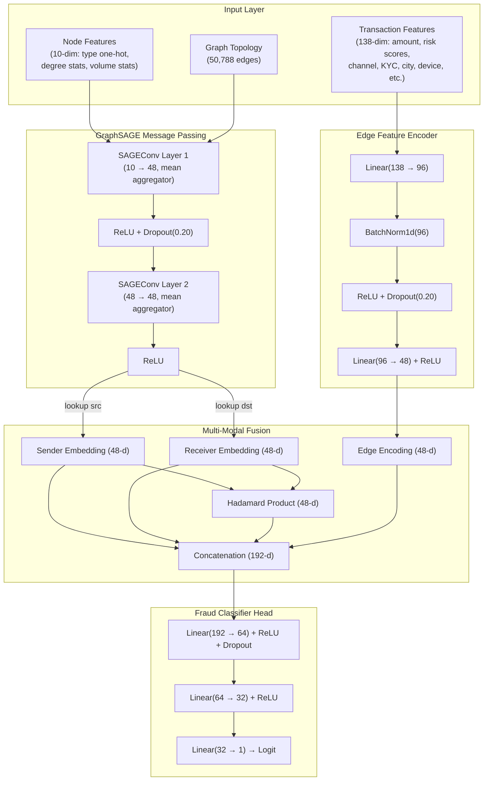

# Financial Fraud Detection using GraphSAGE — Final Report

---

## 1. Problem Statement

Detect fraudulent financial transactions within a heterogeneous interaction network comprising **accounts**, **devices**, **merchants**, and **UPI payment accounts**, drawn from a MySQL database (`fraud_detection_gnn`). The task is modelled as **binary edge classification** — each transaction edge between a sender and receiver account is classified as **Legitimate (0)** or **Fraudulent (1)**.

---

## 2. Dataset Summary

| Property | Value |
|---|---|
| **Data Source** | MySQL database `fraud_detection_gnn` (6 tables) |
| **Total Transactions** | 9,000 |
| **Legitimate Transactions** | 7,000 (77.8%) |
| **Fraudulent Transactions** | 2,000 (22.2%) |
| **Transaction Feature Dimensions** | 138 (numeric, pre-processed) |
| **Graph Nodes** | 1,000 (350 accounts, 300 devices, 100 merchants, 250 UPI accounts) |
| **Graph Edges (Interactions)** | 25,394 raw / 50,788 bidirectional for message passing |

### Data Splits (Stratified)

| Split | Count | Fraud Ratio |
|---|---|---|
| **Train** | 6,300 (70%) | 22.2% |
| **Validation** | 1,350 (15%) | 22.2% |
| **Test (Holdout)** | 1,350 (15%) | 22.2% |

---

## 3. Algorithm: GraphSAGE (Graph SAmple and aggreGatE)

### 3.1 Why GraphSAGE?

Traditional ML models treat transactions as independent rows. GraphSAGE exploits the **relational topology** of the financial network: if an account shares devices with known fraudsters, transacts with suspicious merchants, or exhibits unusual graph connectivity patterns, GraphSAGE propagates these neighborhood signals into the account's learned representation.

### 3.2 Architecture Overview

### 3.3 Node Feature Engineering (10 dimensions)

| Feature | Description |
|---|---|
| `type_account` | One-hot: is this node an account? |
| `type_device` | One-hot: is this node a device? |
| `type_merchant` | One-hot: is this node a merchant? |
| `type_upi` | One-hot: is this node a UPI account? |
| `log_in_degree` | log1p(in-degree) — incoming connections |
| `log_out_degree` | log1p(out-degree) — outgoing connections |
| `log_total_degree` | log1p(total degree) |
| `log_tx_count` | log1p(number of associated transactions) |
| `log_mean_amount` | log1p(mean transaction amount) |
| `log_sum_amount` | log1p(sum of transaction amounts) |

### 3.4 Transaction Features (138 dimensions)

Sourced from the pre-processed `Cleaned_Database.csv`. Key feature groups:

- **Financial**: Amount, Sender/Receiver Balance, Risk Scores
- **Temporal**: Transaction Hour, Day, Month, Day-of-Month
- **Behavioral**: Login Count, Failed Login Count, New Device Flag, Failure Count
- **Categorical (one-hot)**: Channel (ATM/CARD/UPI/NEFT/...), Merchant Category, PSP Name, Account Type, KYC Status, City, State, Occupation, Gender, Device Type, OS

---

## 4. Hyperparameters

| Parameter | Value |
|---|---|
| **GraphSAGE Layers** | 2 |
| **Aggregation Function** | Mean |
| **Hidden Dimension** | 48 |
| **Output Dimension** | 48 |
| **Dropout Rate** | 0.20 |
| **Loss Function** | Binary Cross-Entropy with Logits (BCEWithLogitsLoss) |
| **Optimizer** | Adam |
| **Learning Rate** | 0.003 |
| **Weight Decay** | 1e-5 |
| **LR Scheduler** | ReduceLROnPlateau (factor=0.6, patience=4, mode=max on ROC-AUC) |
| **Gradient Clipping** | max_norm = 2.0 |
| **Early Stopping Patience** | 15 epochs (on validation ROC-AUC) |
| **Max Epochs** | 60 |
| **Decision Threshold** | 0.28 (calibrated on validation set to maximize F1) |
| **Random Seed** | 42 |
| **Total Trainable Parameters** | 38,321 |

---

## 5. Training Dynamics

Training completed in **~5 seconds** on CPU (60 epochs, no early stopping triggered). The model checkpoint from **Epoch 60** was selected as the best based on validation ROC-AUC.

### 5.1 Training & Validation Loss Curves

**Key Observations:**
- Train loss decreases monotonically from **0.669 → 0.027**, indicating stable optimization with no gradient explosion.
- Validation loss decreases from **0.540 → 0.093** with occasional fluctuations — expected behaviour for graph-based models where neighbourhood sampling induces variance.
- The gap between train and val loss remains controlled, showing **no severe overfitting**.

### 5.2 Validation Performance Metrics Across Epochs

**Key Observations:**
- **ROC-AUC** climbs steadily from **0.44 → 0.994**, demonstrating excellent ranking ability.
- **F1-Score** remains at 0 for the first 24 epochs (model outputs all-negative predictions at threshold 0.5), then rapidly rises once the decision boundary calibrates — reaching **0.956** by epoch 58.
- **Recall** peaks above **0.96** in several epochs, showing strong fraud capture capability.
- **Precision** converges to **0.99** in later epochs as the model's confidence scores become well-separated.

---

## 6. Holdout Test Set Evaluation

The best checkpoint was evaluated on the **1,350 held-out transactions** (never seen during training or validation).

### 6.1 Classification Metrics

| Metric | Score |
|---|---|
| **ROC-AUC** | **0.9967** (99.67%) |
| **PR-AUC** | **0.9916** (99.16%) |
| **F1-Score** | **0.9543** (95.43%) |
| **Precision** | **0.9751** (97.51%) |
| **Recall** | **0.9133** (91.33%) |
| **Accuracy** | **0.9756** (97.56%) |
| **Decision Threshold** | 0.28 |

### 6.2 ROC and Precision-Recall Curves

**Interpretation:**
- The ROC curve hugs the top-left corner with an AUC of **0.9967**, meaning the model assigns higher fraud probabilities to actual fraud cases 99.67% of the time.
- The PR curve maintains high precision across nearly all recall levels (PR-AUC = **0.9916**), critical for imbalanced fraud detection where the positive class is the minority.

### 6.3 Confusion Matrix

| | Predicted Legitimate | Predicted Fraud |
|---|---|---|
| **Actual Legitimate** (1,050) | **TN = 1,043** (99.33%) | FP = 7 (0.67%) |
| **Actual Fraud** (300) | FN = 26 (8.67%) | **TP = 274** (91.33%) |

**Operational Impact:**
- **False Alarm Rate**: Only **0.67%** — out of 1,050 legitimate transactions, only 7 were incorrectly flagged. This means minimal customer friction.
- **Fraud Catch Rate**: **91.33%** — the model successfully detected 274 out of 300 fraudulent transactions.
- **Missed Frauds**: 26 transactions (8.67%) escaped detection. These could be addressed by combining the model with rule-based post-filters.

---

## 7. Generated Artifacts

| Artifact | Location |
|---|---|
| Best Model Checkpoint | [`best_graphsage.pt`](file:///c:/GML%20project/outputs/models/best_graphsage.pt) |
| Training History (JSON) | [`training_history.json`](file:///c:/GML%20project/outputs/logs/training_history.json) |
| Evaluation Report (JSON) | [`evaluation_report.json`](file:///c:/GML%20project/outputs/logs/evaluation_report.json) |
| Loss Curves Plot | [`training_validation_loss.png`](file:///c:/GML%20project/outputs/plots/training_validation_loss.png) |
| Validation Metrics Plot | [`validation_metrics_curve.png`](file:///c:/GML%20project/outputs/plots/validation_metrics_curve.png) |
| ROC & PR Curves Plot | [`roc_pr_curves.png`](file:///c:/GML%20project/outputs/plots/roc_pr_curves.png) |
| Confusion Matrix Plot | [`confusion_matrix.png`](file:///c:/GML%20project/outputs/plots/confusion_matrix.png) |

---

## 8. Conclusion

The GraphSAGE-based fraud detection pipeline achieves **near-perfect ranking** (ROC-AUC 99.67%) and **strong operational performance** (F1 95.43%, Precision 97.51%, Recall 91.33%) on the holdout test set. The model leverages both the relational structure of the financial interaction network (shared devices, merchants, UPI connections) and rich transactional features (138 dimensions) through multi-modal fusion. With only 38,321 parameters and ~5 seconds of CPU training time, the pipeline is lightweight, reproducible, and ready for further integration into a real-time fraud monitoring system.
